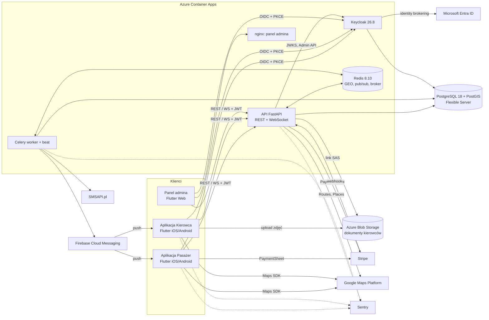

# Podwózka — zarys projektu

**Przedmiot:** Technologie Usługowe i Mobilne · **Nazwa robocza:** Podwózka · **Stan wersji technologii:** zweryfikowane 10.10.2026

## 0. Przyjęte założenia

Nie było danych o terminie, więc przyjmuję:

1. **Zespół: 3 osoby** — po jednej na Mobile, Backend i DevOps (szczegóły w sekcji 9).
2. **Termin oddania: 6.12.2026.** MVP powstaje w tygodniu 24–30.10.2026 z pomocą trzech agentów AI (plan: `docs/plan-tygodnia.md`), reszta czasu to testy, poprawki i przygotowanie do obrony.
3. **Sprzęt:** co najmniej jeden Mac z Xcode w zespole (bez tego nie zbudujecie i nie podpiszecie aplikacji iOS lokalnie).
4. **Konta:** Azure for Students (kredyt + własny tenant Entra ID), Stripe w trybie testowym, Firebase (plan Spark), SonarQube Cloud, Sentry (plan Developer). **Apple Developer Program (99 USD/rok)** — kupiony przez jedną osobę; bez niego iOS działa tylko na symulatorze (patrz ryzyka).
5. **Repozytorium publiczne na GitHubie** (jeśli prowadzący pozwala): darmowe minuty runnerów macOS i brak limitu linii kodu w SonarQube Cloud. Sekrety wyłącznie w GitHub Secrets / Azure.
6. **Model ceny: „cena z góry”** — pasażer widzi i akceptuje stałą cenę przed zamówieniem. Upraszcza płatności (szczególnie BLIK) i jest przejrzysty dla użytkownika.
7. Projekt zaliczeniowy działa na danych testowych. Wymogi prawne realnego startu (licencje, fiskalizacja) są opisane w ryzykach, nie w MVP.

---

## 1. Temat i krótki opis

**Podwózka — mobilna platforma przewozów na żądanie dla małych miejscowości i gmin.**

Podwózka to system typu Uber/Bolt dla gmin, w których duże platformy nie działają. Pasażer zamawia kurs na mapie — od razu albo z wyprzedzeniem — widzi stałą cenę i dojazd kierowcy na żywo, płaci w aplikacji (karta, BLIK, Apple Pay, Google Pay) lub gotówką i ocenia przejazd. Kierowcy rejestrują się w osobnej aplikacji, przechodzą weryfikację dokumentów przez administratora i przyjmują zlecenia. Każda gmina to osobny region z własną strefą, cennikiem i kierowcami. System składa się z dwóch aplikacji Flutter (iOS/Android), panelu administratora, backendu FastAPI z PostgreSQL/PostGIS, osobnego serwera tożsamości Keycloak (z logowaniem administratorów przez Microsoft Entra ID) oraz pipeline'u CI/CD z Quality Gate i wdrożeniem na Azure.

---

## 2. Role użytkowników i główne funkcje

| Rola | Główne funkcje |
|---|---|
| **Pasażer** | Rejestracja i logowanie (Keycloak), weryfikacja numeru telefonu SMS-em · wybór punktów na mapie z podpowiadaniem adresów · wycena przed zamówieniem · zamówienie „teraz” lub rezerwacja na konkretną godzinę · śledzenie kierowcy i ETA na żywo · płatność kartą/BLIK/Apple Pay/Google Pay lub gotówką · anulowanie · ocena kierowcy · historia przejazdów · usunięcie konta |
| **Kierowca** | Rejestracja i wniosek kierowcy (dane auta, zdjęcia dokumentów) · status wniosku · przełącznik „online/offline” · przyjmowanie/odrzucanie zleceń (z limitem czasu) · **giełda rezerwacji** — przyjmowanie kursów zaplanowanych z wyprzedzeniem · zmiany statusu kursu (dojeżdżam, na miejscu, w trakcie, zakończony) · nawigacja przez przekazanie trasy do Google Maps/Waze · potwierdzenie przyjęcia gotówki · historia kursów i zarobków · ocena pasażera |
| **Administrator** | Logowanie przez Microsoft Entra ID · przegląd i zatwierdzanie/odrzucanie wniosków kierowców (z podglądem dokumentów) · zawieszanie kierowców · zarządzanie regionami (gminy: granica jako poligon GeoJSON, aktywność) · zarządzanie wersjonowanymi cennikami regionów · podgląd kursów i rozliczeń gotówkowych |

**Wyróżniki w funkcjach:** rezerwacje z wyprzedzeniem przyjmowane przez kierowcę z dużym zapasem czasu (rozwiązuje problem małej liczby kierowców), gotówka jako pełnoprawna metoda z rozliczeniem prowizji, wieloregionowość od pierwszego dnia (region wyznaczany automatycznie z punktu odbioru).

---

## 3. Stos technologiczny

### 3.1. Zmiany względem wstępnego wyboru (podsumowanie)

| # | Zmiana | Uzasadnienie |
|---|---|---|
| 1 | Python **3.14.8** zamiast „3.13+” | 3.13 zakończył fazę poprawek błędów 1.10.2026 (zostają tylko łatki bezpieczeństwa). 3.15.0 wyszedł 9.10.2026 — za świeży, część bibliotek z rozszerzeniami w C (asyncpg, uvloop) może jeszcze nie mieć kół. Przejście na 3.15 po ok. 1–2 miesiącach. |
| 2 | PostgreSQL **18.6** zamiast 17 | 18 to najnowsza stabilna gałąź (17 nadal wspierana, ale bez powodu, żeby zaczynać od starszej). 19 jest wciąż w fazie beta. PG 18 jest GA w Azure Database for PostgreSQL. |
| 3 | **Celery** zamiast ARQ | ARQ jest oficjalnie w trybie „maintenance only”. Celery to dojrzały standard z harmonogramem (beat) potrzebnym do rezerwacji. |
| 4 | **SonarQube Cloud** (dawniej SonarCloud) | Zmiana nazwy produktu. Darmowy plan: repozytoria prywatne do 50 tys. linii kodu, do 5 użytkowników, analiza PR i gałęzi głównej, domyślny Quality Gate „Sonar way”; publiczne repozytoria bez limitu linii. Wspiera Dart/Flutter (Dart 3–3.13). |
| 5 | Mapy: **google_maps_flutter** + Google Routes/Places przez backend; bez flutter_map/ORS w MVP | Maps SDK na Androida/iOS jest w cenniku Google bez limitu i bez opłat. Google lepiej geokoduje adresy wiejskie niż Nominatim (którego zasady użycia zabraniają też intensywnego autouzupełniania). Adapter w backendzie pozwala później podmienić dostawcę. |
| 6 | Panel admina jako **Flutter Web** w tym samym repo | Reużycie pakietu `core` (auth, klient API, modele) bez dokładania nowego frameworka. |
| 7 | Monorepo przez **Dart pub workspaces** (bez Melos) | Workspaces są wbudowane w Dart i wystarczają do wspólnego pakietu `core`. Melos tylko, jeśli zabraknie skryptów. |
| 8 | Nawigacja kierowcy przez **przekazanie trasy** do Google Maps/Waze (`url_launcher`) | Własna nawigacja zakręt po zakręcie to osobny produkt; kierowcy i tak jej używają. |
| 9 | Dodane **Azure Blob Storage** | Potrzebne do zdjęć dokumentów kierowców (upload bezpośrednio z aplikacji przez krótkotrwały link SAS). |
| 10 | Active Directory (LDAP) → **rozszerzenie** | W MVP Entra ID przez identity brokering. Federacja LDAP z AD jako drugi etap (wymaga działającego AD). |

Redis zostaje (**8.10**). Jeśli licencja (RSALv2/SSPLv1/AGPLv3) budziłaby wątpliwości przy komercjalizacji, **Valkey 9.1** jest zamiennikiem bez zmian w kodzie.

### 3.2. Mobile

| Technologia | Wersja | Do czego służy | Dlaczego ta |
|---|---|---|---|
| Flutter / Dart | **3.47.1** / **3.13.1** | Aplikacje Pasażer, Kierowca i panel admina (web) | Jeden kod na iOS i Android, dopuszczony przez prowadzącego. Na semestr zamrażamy 3.47.x (Flutter 3.50 planowany na listopad 2026). |
| Xcode | **27** (patch potwierdzić w App Store) | Build i podpisywanie iOS | App Store przyjmuje buildy z SDK iOS 27 od 10.09.2026. |
| Android Studio | **2026.2.1** | Build Android, emulator | Bieżąca stabilna wg Android Developers. |
| Dart pub workspaces | wbudowane w Dart 3.13 | Monorepo w `mobile/`: `apps/passenger`, `apps/driver`, `apps/admin_web`, `packages/core`, `packages/api_client` | Bez dodatkowego narzędzia. |
| flutter_riverpod | **3.4.3** | Stan aplikacji, DI | Standard w nowych projektach Flutter, dobra testowalność. |
| go_router | **18.0.2** | Routing, deep linki, przekierowania zależne od logowania | Oficjalny pakiet zespołu Flutter. |
| Material 3 | w Flutter SDK | UI | Domyślny system projektowy. |
| google_maps_flutter | **2.18.2** | Mapa, znaczniki kierowców, trasa | Maps SDK mobilny bez opłat. |
| geolocator | **14.1.1** | Lokalizacja pasażera i kierowcy (kierowca: Android foreground service) | Najpopularniejszy pakiet lokalizacji z obsługą pracy w tle. |
| url_launcher | **6.3.3** | Przekazanie trasy do Google Maps/Waze, telefon do pasażera | Oficjalny pakiet. |
| flutter_appauth | **12.1.0** | OAuth 2.0 / OIDC z PKCE do Keycloaka (systemowa przeglądarka) | Zgodny z RFC 8252 (native apps); Keycloak nie musi znać hasła w aplikacji. |
| flutter_secure_storage | **11.2.0** | Przechowywanie tokenów (Keychain/Keystore) | Bezpieczne przechowywanie refresh tokenów. |
| dio | **5.11.1** | Klient HTTP (interceptor dokładający token, odświeżanie) | Wymagany przez generator `dart-dio`. |
| OpenAPI Generator (`dart-dio`) | **wersję potwierdzić** (najnowsze wydanie 7.x) | Generowanie `packages/api_client` z `openapi.json` FastAPI | Jeden kontrakt API dla backendu i aplikacji; CI wykrywa rozjazd. |
| web_socket_channel | **3.0.3** | Śledzenie kursu na żywo, wysyłanie pozycji kierowcy | Oficjalny pakiet Dart. |
| flutter_stripe | **14.1.0** | PaymentSheet: karta, BLIK, Apple Pay, Google Pay | Oficjalnie wspierany przez Stripe SDK mobilne. |
| firebase_messaging | **16.7.0** | Push: nowe zlecenie, zmiana statusu, przypomnienie o rezerwacji | Jedyny darmowy kanał push na iOS i Android jednocześnie. |
| sentry_flutter | **10.0.0** | Błędy i crashe aplikacji | Wydanie 10.0.0 jest z 9.10.2026 — jeśli sprawi problemy, użyć ostatniej 9.x. |

### 3.3. Backend

| Technologia | Wersja | Do czego służy | Dlaczego ta |
|---|---|---|---|
| Python | **3.14.8** | Środowisko uruchomieniowe | Patrz zmiana #1. `requires-python = ">=3.14,<3.16"`. |
| FastAPI | **0.143.0** | REST + WebSocket, automatyczny OpenAPI | Async, typowanie, generowanie kontraktu dla klienta mobilnego. Wersja 0.x — przypinamy minor w `uv.lock`. |
| Uvicorn | **0.54.0** | Serwer ASGI | Standardowy serwer dla FastAPI. |
| Pydantic / pydantic-settings | **2.14.0** / **2.15.0** | Walidacja, schematy, konfiguracja z env | Fundament FastAPI. |
| SQLAlchemy (async) + asyncpg | **2.1.4** + **0.32.0** | ORM i sterownik PostgreSQL | 2.1 to aktualna stabilna gałąź; asyncpg — najszybszy sterownik async. |
| GeoAlchemy2 | **0.20.0** | Typy PostGIS (Point, Polygon) w SQLAlchemy | Łączy PostGIS z ORM. |
| Alembic | **1.20.0** | Migracje schematu | Standard dla SQLAlchemy. |
| PyJWT | **2.15.1** | Weryfikacja JWT z Keycloaka (`PyJWKClient` z cache JWKS) | Lekka biblioteka; backend nie potrzebuje pełnego klienta OIDC. |
| httpx | **0.28.1** | Wywołania Keycloak Admin API, Google Routes/Places, SMSAPI | Async, łatwy do mockowania w testach. |
| Celery | **5.6.3** | Zadania w tle: timeout ofert, harmonogram rezerwacji (beat), push, SMS | Patrz zmiana #3. |
| redis-py | **8.1.0** | Klient Redis (GEO, pub/sub) | Oficjalny klient, wspiera asyncio. |
| stripe (Python) | **16.0.0** | PaymentIntents, webhooki | Oficjalne SDK. |
| firebase-admin | **7.7.0** | Wysyłka push przez FCM HTTP v1 | Oficjalne SDK. |
| azure-storage-blob | **12.31.0** | Generowanie linków SAS do uploadu dokumentów | Oficjalne SDK. |
| sentry-sdk | **2.71.0** | Błędy i wydajność backendu | Integracja z FastAPI i Celery. |
| uv | **0.13.0** | Menedżer pakietów, lockfile, wersja Pythona | Szybki, jeden plik `uv.lock`. |
| ruff | **0.17.0** | Lint + formatowanie | Zastępuje flake8/isort/black. |
| pytest / pytest-cov | **9.1.1** / **7.1.0** | Testy i pokrycie | Standard; raport XML dla SonarQube. |

**Architektura backendu: modularny monolit** — jeden proces API i jeden worker, podział na moduły `users`, `drivers`, `regions`, `pricing`, `rides`, `dispatch`, `payments`, `notifications`. Każdy moduł ma własne `router.py`, `service.py`, `models.py`, `schemas.py`; moduły komunikują się przez serwisy, nie przez cudze tabele. Integracje zewnętrzne za interfejsami (`RoutingProvider`, `GeocodingProvider`, `PaymentProvider`, `PushSender`, `SmsSender`, `DocumentStorage`) z implementacją produkcyjną i testową (fake).

### 3.4. Baza danych i dane w pamięci

| Technologia | Wersja | Do czego służy | Dlaczego ta |
|---|---|---|---|
| PostgreSQL | **18.6** | Główne źródło prawdy: użytkownicy, kursy, płatności, cenniki; osobna baza dla Keycloaka | Patrz zmiana #2. Na Azure: Flexible Server (PG 18 GA). |
| PostGIS | **3.6.x** (≥ 3.6.4) | Granice gmin (poligony), przypisanie punktu odbioru do regionu, zapis trasy | Standard GIS dla PostgreSQL, wspiera PG 18. Obraz lokalny: `postgis/postgis:18-3.6`. |
| Redis | **8.10.2** | Bieżące pozycje kierowców online (`GEOADD`/`GEOSEARCH` per region), pub/sub do WebSocketów między replikami, broker Celery | Dane ulotne — utrata Redisa nie gubi kursów, bo stan jest w PostgreSQL. |

### 3.5. Autentykacja

| Technologia | Wersja | Do czego służy | Dlaczego ta |
|---|---|---|---|
| Keycloak | **26.8.0** | Serwer tożsamości OIDC: realm `podwozka`, role `passenger`/`driver`/`admin`, rejestracja, reset hasła | Sugerowany przez prowadzącego; brokering Entra ID i federacja LDAP/AD w standardzie. Projekt nie ma LTS — wspierana jest tylko najnowsza wersja, więc aktualizujemy regularnie. |
| Microsoft Entra ID | usługa SaaS | Logowanie administratorów (Keycloak jako broker OIDC) | Wymaganie prowadzącego; MFA i polityki z tenanta. |
| Active Directory (LDAP) | — | Rozszerzenie: federacja użytkowników AD w Keycloaku | Patrz zmiana #10. |

### 3.6. Zewnętrzne API

| Usługa | Wersja | Do czego służy | Dlaczego ta |
|---|---|---|---|
| Stripe (tryb testowy) | API wg SDK 16.0.0 | Karta, BLIK, Apple Pay, Google Pay, webhooki | BLIK dostępny w Stripe dla PLN. **Uwaga:** BLIK nie wspiera ręcznego „capture” (blokady środków) — dlatego model „cena z góry” (patrz 4.3). |
| Google Maps Platform | Maps SDK, Routes API, Places API (New), Geocoding | Mapa, trasa i czas przejazdu do wyceny, podpowiadanie adresów | Maps SDK mobilny bez opłat; pozostałe SKU mają miesięczne darmowe limity (np. Dynamic Maps 10 tys. zdarzeń). Wywołania Routes/Places tylko przez backend (klucz ukryty, cache, limity). |
| Firebase Cloud Messaging | HTTP v1 | Push do obu aplikacji | Darmowy. Na iOS wymaga klucza APNs (konto Apple Developer). |
| SMSAPI.pl | REST | Kod weryfikacyjny telefonu (OTP) | Polski operator; tryb testowy bez wysyłki. Wywołanie przez httpx, bez dodatkowej biblioteki. |
| SMTP (dowolny dostawca; lokalnie Mailpit) | wersję obrazu Mailpit potwierdzić | E-maile Keycloaka: weryfikacja adresu, reset hasła | Keycloak bez SMTP nie wyśle maila resetu hasła. |

### 3.7. DevOps

| Technologia | Wersja | Do czego służy | Dlaczego ta |
|---|---|---|---|
| Docker Engine + Compose v2 | **29.9.0** | Obrazy, lokalne środowisko (API, worker, Postgres, Redis, Keycloak, Mailpit) | Jedno polecenie `docker compose up`. |
| GitHub Actions | usługa | CI/CD | Wymaganie prowadzącego. |
| GitHub Container Registry | usługa | Rejestr obrazów | Zintegrowany z GitHubem, darmowy dla publicznych repo. |
| SonarQube Cloud | usługa | Analiza statyczna Python + Dart, pokrycie, Quality Gate | Patrz zmiana #4. Do skanowania Darta `sonarqube-scan-action` w wersji ≥ v6. |
| Dependabot | usługa GitHub | Aktualizacje zależności (pip, pub, Docker, Actions) | Wbudowany w GitHub; ważny przy Keycloaku bez LTS. |
| Azure Container Apps | usługa (plan Consumption) | Hosting: API, worker, Keycloak, Redis, panel admina (nginx) | Kontenery bez Kubernetesa, scale-to-zero, wsparcie WebSocketów. Darmowo co miesiąc: 180 tys. vCPU-s, 360 tys. GiB-s, 2 mln żądań. |
| Azure Database for PostgreSQL – Flexible Server | PG 18 | Zarządzana baza z PostGIS | Kopie zapasowe i aktualizacje po stronie Azure. |
| Azure Blob Storage | usługa | Dokumenty kierowców | Patrz zmiana #9. |
| Fastlane | **2.240.1** | Podpisywanie i wysyłka buildów: TestFlight, Firebase App Distribution | Standard automatyzacji mobile w CI. |
| Firebase App Distribution / TestFlight | usługi | Dystrybucja testowa Android / iOS | Bez przeglądu w sklepach na etapie MVP (TestFlight dla testerów wewnętrznych). |
| Sentry | usługa (SDK jw.) | Monitoring błędów backendu i aplikacji | Darmowy plan wystarcza. |

---

## 4. Architektura

### 4.1. Komponenty

- **Aplikacja Pasażer, Aplikacja Kierowca (Flutter)** — wspólny pakiet `core`: logowanie (AppAuth), klient API (wygenerowany), klient WebSocket, motyw, widgety mapy.
- **Panel admina (Flutter Web)** — statyczny build serwowany przez nginx w ACA.
- **API (FastAPI)** — REST dla operacji, WebSocket `/ws` dla kursu na żywo; bezstanowe, skalowane poziomo.
- **Worker + beat (Celery)** — oferty z limitem czasu, uruchamianie dyspozycji rezerwacji, push, SMS.
- **Keycloak** — tożsamość i role; broker do Entra ID.
- **PostgreSQL + PostGIS** — trwały stan systemu. **Redis** — pozycje online, pub/sub, kolejka.
- **Blob Storage** — pliki dokumentów (prywatny kontener, dostęp tylko przez SAS).

### 4.2. Diagram

### 4.3. Przepływ danych — kurs „teraz”

1. **Wycena:** aplikacja wysyła punkty odbioru i celu → API ustala region zapytaniem PostGIS (`ST_Contains(region.area, pickup)`), pobiera dystans i czas z Routes API, liczy cenę wg aktywnego cennika regionu. Zwraca `quote_id` ważne 5 minut (ceny w groszach, liczby całkowite).
2. **Zamówienie:** `POST /rides` z `quote_id` i metodą płatności.
   - **Karta / Apple Pay / Google Pay:** PaymentIntent z `capture_method=manual` (blokada środków), pobranie po zakończeniu kursu.
   - **BLIK:** brak ręcznego capture, więc płatność pobierana od razu po zamówieniu; przy anulowaniu bez winy pasażera — automatyczny zwrot.
   - **Gotówka:** bez Stripe; kierowca potwierdza przyjęcie po kursie.
   Stan płatności potwierdza **webhook** Stripe (idempotentnie), nie aplikacja.
3. **Dyspozycja:** API szuka kierowców `GEOSEARCH drivers:online:{region}` w promieniu, filtruje wolnych i zatwierdzonych, wysyła ofertę najbliższemu (WebSocket + push). Celery odlicza 20 s; brak akceptacji → następny kierowca. Po wyczerpaniu kandydatów: status `no_driver` i zwrot/zwolnienie blokady.
4. **Na żywo:** aplikacja kierowcy wysyła pozycję co 3–5 s przez WebSocket → `GEOADD` + publikacja na kanale `ride:{id}` → każda replika API przekazuje ją pasażerowi podłączonemu do siebie. Zmiany statusu idą tą samą drogą i są zapisywane w `ride_events`.
5. **Zakończenie:** capture płatności (lub potwierdzenie gotówki), wpis do rejestru zarobków kierowcy (kwota, prowizja, netto), prośba o ocenę.

**Kurs zaplanowany:** rezerwacja trafia na giełdę rezerwacji regionu; kierowca może przyjąć ją z wyprzedzeniem. Celery beat co minutę: przypomnienie kierowcy na 60 min przed, a jeśli nikt nie przyjął do T−30 min — uruchomienie zwykłej dyspozycji i powiadomienie pasażera. Stan rezerwacji jest w PostgreSQL, więc restart workera niczego nie gubi.

**Uwierzytelnianie WebSocketu:** token przekazywany w pierwszej wiadomości po połączeniu (nie w URL — nie trafia do logów); połączenie zamykane przy wygaśnięciu tokenu.

---

## 5. Przepływ autentykacji

**Konfiguracja Keycloaka (realm `podwozka`, eksport JSON w repo, import przy starcie):**
- Klienci publiczni z PKCE: `passenger-app`, `driver-app`, `admin-panel`. Klient poufny `podwozka-backend` z kontem serwisowym (rola `manage-users`) do Admin API.
- Mapper audience `podwozka-api`; access token 5 min, refresh token rotowany.
- Backend weryfikuje: podpis (JWKS, cache), `iss`, `aud`, `exp`, `azp` ∈ dozwolonych klientów, role z `realm_access.roles`.

### 5.1. Rejestracja pasażera
1. Aplikacja otwiera stronę Keycloaka w systemowej przeglądarce (`flutter_appauth`, PKCE) → „Zarejestruj się” (samorejestracja włączona tylko dla tego realmu).
2. Keycloak wysyła e-mail weryfikacyjny; nowy użytkownik dostaje domyślną rolę `passenger`.
3. Aplikacja dostaje tokeny, zapisuje je w `flutter_secure_storage`, wywołuje `PUT /me` → backend tworzy profil po `sub`.
4. Weryfikacja telefonu: backend wysyła OTP przez SMSAPI, zapisuje `phone_verified`. Bez tego nie można zamówić kursu.
5. Usunięcie konta (wymóg App Store): `DELETE /me` → backend usuwa użytkownika w Keycloaku przez Admin API i anonimizuje historię kursów (zostają dane rozliczeniowe).

### 5.2. Rejestracja i weryfikacja kierowcy
1. Logowanie/rejestracja w aplikacji Kierowca — ten sam mechanizm; konto bez roli `driver`.
2. Aplikacja pokazuje onboarding: dane pojazdu, region, `POST /drivers/applications`.
3. Dla każdego dokumentu (prawo jazdy, dowód rejestracyjny, OC, zdjęcie) backend zwraca jednorazowy link SAS → aplikacja wysyła plik bezpośrednio do Blob Storage → backend zapisuje metadane i datę ważności. Wniosek: `pending`.
4. Admin w panelu ogląda dokumenty (link SAS tylko do odczytu, ważny kilka minut) → **zatwierdza** lub odrzuca z powodem.
5. Po zatwierdzeniu backend przez Keycloak Admin API nadaje rolę `driver`, ustawia `driver_profile.status=approved`, wysyła push. Aplikacja odświeża token.
6. Endpointy kierowcy wymagają **roli `driver` w tokenie i statusu `approved` w bazie** — zawieszenie działa natychmiast, bez czekania na wygaśnięcie tokenu.

### 5.3. Logowanie administratora (Entra ID / AD)
1. W Entra ID: rejestracja aplikacji (OIDC), grupa `Podwozka-Admins`, claim grup w tokenie.
2. W Keycloaku: Identity Provider „Microsoft/OIDC” (alias `entra`) + mapper: członkostwo w grupie → rola `admin`.
3. Klient `admin-panel` ma nadpisany browser flow zawierający tylko **Identity Provider Redirector → `entra`** — administrator nie może zalogować się hasłem lokalnym; MFA wymusza tenant Entra.
4. Panel dostaje token Keycloaka z rolą `admin`; backend nie wie nic o Entra — widzi tylko tokeny Keycloaka.
5. **Rozszerzenie AD:** User Federation LDAPS do Active Directory + mapper grup LDAP → rola `admin`; ten sam panel, inna ścieżka w Keycloaku.

---

## 6. Główne encje bazy danych

| Encja | Kluczowe pola |
|---|---|
| `users` | `id` (= `sub` z Keycloaka), imię, telefon, `phone_verified`, `deleted_at` |
| `regions` | nazwa gminy, kod TERYT, `area` (Polygon/MultiPolygon, SRID 4326), strefa czasowa, `active` |
| `tariffs` | `region_id`, opłata startowa, stawka/km, stawka/min, cena minimalna, mnożnik nocny, `valid_from`/`valid_to` (wersjonowanie — kurs zapamiętuje użytą wersję) |
| `driver_profiles` | `user_id`, `region_id`, status (`pending`/`approved`/`rejected`/`suspended`), średnia ocen |
| `vehicles` | `driver_id`, marka, model, kolor, nr rejestracyjny, liczba miejsc |
| `driver_documents` | `driver_id`, typ, ścieżka w Blob, `expires_at`, status, komentarz admina |
| `quotes` | punkty, dystans, czas, cena, `tariff_id`, `expires_at` |
| `rides` | pasażer, kierowca, region, status, punkty i adresy (Point), `scheduled_at`, cena, metoda płatności, dystans, czas, trasa (LineString) |
| `ride_events` | `ride_id`, status, czas, autor — audyt maszyny stanów |
| `ride_offers` | `ride_id`, `driver_id`, wysłana/zaakceptowana/odrzucona/wygasła |
| `payments` | `ride_id`, dostawca, `provider_intent_id`, metoda, kwota, status, zwroty |
| `ratings` | `ride_id`, od kogo, dla kogo, gwiazdki, komentarz |
| `driver_ledger` | `driver_id`, `ride_id`, brutto, prowizja, netto, `cash_collected`, rozliczenie |
| `device_tokens` | `user_id`, token FCM, platforma |

**Statusy kursu:** `requested` → (`scheduled`) → `dispatching` → `accepted` → `driver_arriving` → `arrived` → `in_progress` → `completed`; boczne: `cancelled_by_passenger`, `cancelled_by_driver`, `no_driver`. Przejścia tylko przez serwis `rides` (testowane jednostkowo).

---

## 7. Pipeline CI/CD

Jedno repo, osobne workflowy z filtrami ścieżek (`backend/**`, `apps/**`, `packages/**`, `infra/**`).

### 7.1. Pull request do `main`
1. **Backend:** `uv sync --locked` → `ruff check` + `ruff format --check` → `pytest --cov` z usługami Postgres (`postgis/postgis:18-3.6`) i Redis w GitHub Actions → raport pokrycia XML.
2. **Mobile:** `flutter pub get` (workspace) → `dart format --set-exit-if-changed` → `flutter analyze` → `flutter test --coverage` (lcov) dla `core` i aplikacji.
3. **Kontrakt API:** wygenerowanie `openapi.json` z FastAPI i klienta Dart; jeśli wynik różni się od wersji w repo — błąd (backend i aplikacje nie mogą się rozjechać).
4. **Build kontrolny:** `docker build` obrazów API/worker (bez publikacji).
5. **SonarQube Cloud:** jedna analiza monorepo (Python + Dart, oba raporty pokrycia) → oczekiwanie na wynik Quality Gate.
6. **Ochrona gałęzi `main`:** wymagane statusy (lint, testy, kontrakt, Quality Gate), 1 zatwierdzające review, zakaz bezpośredniego pusha, historia liniowa.

### 7.2. Quality Gate
Darmowy plan SonarQube Cloud korzysta z domyślnej bramki **„Sonar way”**, liczonej dla **nowego kodu** w PR:
- pokrycie testami nowego kodu ≥ 80%,
- duplikacje w nowym kodzie ≤ 3%,
- brak nowych błędów i podatności (oceny niezawodności i bezpieczeństwa A),
- oceny utrzymywalności A,
- 100% przejrzanych „security hotspots”.

Nieprzejście bramki = czerwony wymagany status = **merge zablokowany**. Z pokrycia wyłączamy tylko kod generowany (`packages/api_client`, `*.g.dart`) i migracje Alembic — jawnie w `sonar-project.properties`.

### 7.3. Merge do `main` → środowisko staging
1. Build i push obrazów do GHCR z tagiem SHA commita.
2. Logowanie do Azure przez **OIDC (federated credentials)** — bez haseł w sekretach.
3. Migracje: Alembic uruchamiany jako **ACA Job** z nowym obrazem.
4. Nowa rewizja API i workera w ACA → smoke test `/health` → przy błędzie powrót do poprzedniej rewizji.
5. Android: `flutter build apk` → Fastlane → **Firebase App Distribution**.
6. iOS (runner macOS): `flutter build ipa` → Fastlane (certyfikaty przez `match`, App Store Connect API key) → **TestFlight**.

### 7.4. Tag `v*` → produkcja (opcjonalnie w ramach przedmiotu)
Ten sam obraz co na staging (bez przebudowy) + ręczne zatwierdzenie w GitHub Environments.

---

## 8. Zakres MVP i rozszerzenia

### 8.1. MVP (na zaliczenie)
- Rejestracja/logowanie pasażera i kierowcy (Keycloak, PKCE), weryfikacja telefonu, usunięcie konta.
- Logowanie admina przez Entra ID.
- 2 zasiane regiony (np. dwie sąsiednie gminy) z różnymi cennikami — demonstracja wieloregionowości.
- Wycena „z góry”, zamówienie teraz i na później, giełda rezerwacji.
- Dyspozycja do najbliższego kierowcy z limitem czasu, śledzenie na żywo, statusy, anulowanie.
- Płatności testowe: karta, BLIK, Google Pay (Apple Pay jeśli jest konto Apple), gotówka.
- Oceny, historia kursów, zarobki kierowcy (z rozróżnieniem gotówki).
- Panel admina: wnioski kierowców z dokumentami, regiony (import GeoJSON), cenniki.
- Push dla kluczowych zdarzeń; Sentry w aplikacjach i backendzie.
- CI/CD z Quality Gate, staging na ACA, APK w Firebase App Distribution, build iOS w TestFlight.

### 8.2. Rozszerzenia
- Wypłaty kierowcom przez **Stripe Connect** (kierowcy jako konta połączone).
- Federacja **Active Directory (LDAP)**; logowanie Google/Apple dla pasażerów (przy Google — także Sign in with Apple, wymóg App Store).
- **Zamawianie telefoniczne przez dyspozytora** (panel call-center) — ważne dla starszych mieszkańców małych gmin.
- Fiskalizacja/paragony, faktury dla firm.
- Admin regionalny (uprawnienia per gmina), raporty dla gmin.
- Dopłata za zmianę trasy, napiwki, kody promocyjne, przejazdy współdzielone.
- Infrastruktura jako kod (Bicep), środowisko produkcyjne z osobną bazą.
- Publikacja w Google Play i App Store.

---

## 9. Podział pracy

| Osoba | Obszar | Odpowiedzialność |
|---|---|---|
| **Mobile** | Obie aplikacje + `core` | Pakiet `core` (auth, klient API, WebSocket, mapa, motyw), aplikacja Pasażer (wybór adresu, wycena, zamówienie, śledzenie, Stripe PaymentSheet, oceny), aplikacja Kierowca (lokalizacja w tle, oferty, giełda rezerwacji, statusy kursu, zarobki, upload dokumentów) |
| **Backend** | API i dane | Modele i migracje, moduły `rides`/`dispatch`/`pricing`/`regions`/`payments`/`drivers`, WebSocket, Celery, adaptery integracji (Stripe, Google, FCM, SMSAPI, Blob), kontrakt OpenAPI, testy |
| **DevOps** | Infra, CI/CD, tożsamość + panel admina | docker-compose, realm Keycloak jako kod, Entra ID, workflowy GitHub Actions, SonarQube Cloud, Azure (ACA, Postgres, Blob), Fastlane, Sentry, sekrety; **od ok. 6. tygodnia panel admina w Flutter Web** na gotowym `core` |

**Dlaczego panel admina u DevOps:** logowanie admina przez Entra ID i tak jest po jego stronie, a po ustawieniu CI/CD i infrastruktury (tyg. 1–5) jego obciążenie spada. Mobile ma najwięcej pracy (dwie aplikacje), więc nie dostaje panelu.

**Zasady pracy w 3 osoby:**
- Kontrakt OpenAPI ustalany na początku każdej funkcji — Mobile pracuje na wygenerowanym kliencie i mockach, nie czeka na backend.
- Każdy PR przegląda jedna z dwóch pozostałych osób (wymagane 1 review).
- Backend pomaga Mobile przy testach logiki w `core` (providery Riverpod są zwykłym kodem Dart).

**Kolejność cięcia zakresu, jeśli zabraknie czasu** (od pierwszego do odcięcia): Apple Pay → ocena pasażera przez kierowcę → weryfikacja telefonu SMS (zostaje tylko e-mail z Keycloaka) → build iOS w TestFlight (iOS tylko na symulatorze). Rdzeń — kurs teraz i na później, wieloregionowość, gotówka i karta, weryfikacja kierowcy, Entra ID, CI/CD z Quality Gate — zostaje zawsze.

**Harmonogram:** MVP w tydzień (24–30.10.2026) według `docs/plan-tygodnia.md` — trzy agenty AI równolegle, po jednym na obszar, prowadzone przez właścicieli obszarów. Od 31.10 do oddania 6.12: testy na telefonach, TestFlight, rozszerzenia (SMS, Apple Pay, AD), dokumentacja i obrona.

---

## 10. Główne ryzyka

| Ryzyko | Skutek | Ograniczenie |
|---|---|---|
| **Koszty Google Maps** | Rachunek po przekroczeniu darmowych limitów | Mapy mobilne (Maps SDK) bez opłat; Routes/Places tylko przez backend z cache wycen i limitem żądań na użytkownika; autouzupełnianie z debounce i tokenami sesji; budżet i alert w Google Cloud; klucze ograniczone do pakietu/bundle ID; adapter pozwala przejść na OpenRouteService. |
| **Publikacja w App Store** | Brak iOS na demo, odrzucenie w review | Konto Apple Developer na start semestru; TestFlight dla testerów wewnętrznych nie wymaga review; od początku: usuwanie konta w aplikacji, uzasadnienie lokalizacji „zawsze” w aplikacji Kierowca. Płatności za przejazd mogą iść przez Stripe (usługa fizyczna, nie zakup cyfrowy). |
| **RAM i czas startu Keycloaka** | Bazowo ok. 1,25 GB RAM na instancję; wolny start | Lokalnie `start-dev`, w chmurze obraz zbudowany wcześniej (`kc.sh build`, start `--optimized`), min. 1 replika; zespół z laptopami 8 GB: Keycloak współdzielony na staging zamiast lokalnie. |
| **Koszty Azure** | Keycloak działający ciągle przekracza darmowy limit ACA (180 tys. vCPU-s/mies.) | Kredyt Azure for Students; scale-to-zero dla API/panelu poza demo; najmniejsza sensowna konfiguracja Keycloaka; alert budżetu. Plan B: jeden VPS z tym samym `docker-compose`. |
| **Minuty runnerów macOS** | Przy prywatnym repo minuty macOS liczone wielokrotnie | Publiczne repo; build iOS tylko po merge do `main`, nie w każdym PR. |
| **Quality Gate blokuje pracę** | 80% pokrycia nowego kodu blokuje merge pod koniec semestru | Testy od pierwszego tygodnia; logika biznesowa w testowalnych serwisach/providerach, nie w widgetach; wykluczenia tylko dla kodu generowanego. |
| **Lokalizacja w tle (kierowca)** | Zabijanie aplikacji przez system, bateria, odrzucenie w sklepach | Android foreground service z powiadomieniem tylko w trybie „online”; adaptacyjny interwał wysyłki; testy na prawdziwych telefonach. |
| **BLIK bez ręcznego capture** | Nie da się zablokować środków na czas kursu | Cena z góry, pobranie przy zamówieniu, automatyczny zwrot przy anulowaniu. |
| **Jedna osoba na dwie aplikacje mobilne** | Mobile staje się wąskim gardłem całego projektu | Wspólny pakiet `core` od 1. tygodnia; klient API generowany automatycznie; panel admina przeniesiony do DevOps; ustalona kolejność cięcia zakresu (sekcja 9). |
| **Mała liczba kierowców** | Brak realizacji kursów | Giełda rezerwacji, przypomnienia, jasny komunikat dla pasażera i zwrot płatności przy `no_driver`. |
| **Nowe wersje w trakcie semestru** | Flutter 3.50 (listopad), Python 3.15, Keycloak bez LTS | Zamrożenie Fluttera na 3.47.x; Python 3.14 do czasu dojrzenia 3.15; Keycloak — aktualizacje minor przez Dependabota co kilka tygodni. |
| **Tenant Entra ID** | Uczelniany tenant może blokować rejestrację aplikacji | Własny tenant powiązany z subskrypcją Azure for Students. |
| **Prawo (realne wdrożenie)** | Działanie bez wymaganych licencji | Przed startem komercyjnym: licencja pośrednika przy przewozie osób i licencje kierowców (ustawa o transporcie drogowym), RODO dla danych lokalizacyjnych i dokumentów (retencja, umowy powierzenia), fiskalizacja. Poza zakresem przedmiotu. |

---

## Źródła wersji (stan 10.10.2026)

- Flutter/Dart: [Flutter versions (Shorebird)](https://docs.shorebird.dev/getting-started/flutter-version.md), [harmonogram wydań Flutter 2026](https://docs.flutter.dev/install/archive)
- Pakiety Flutter: [pub.dev](https://pub.dev) (API pakietów: flutter_riverpod, go_router, google_maps_flutter, geolocator, url_launcher, flutter_appauth, flutter_secure_storage, dio, web_socket_channel, flutter_stripe, firebase_messaging, sentry_flutter)
- Pakiety Python: [PyPI](https://pypi.org) (fastapi, uvicorn, pydantic, sqlalchemy, asyncpg, geoalchemy2, alembic, pyjwt, httpx, celery, redis, stripe, firebase-admin, azure-storage-blob, sentry-sdk, uv, ruff, pytest)
- Python: [endoflife.date/python](https://endoflife.date/python), [Python 3.15.0](https://www.python.org/downloads/release/python-3150/)
- PostgreSQL: [postgresql.org](https://www.postgresql.org/) · PostGIS: [pgEdge — PostGIS 3.6.4](https://docs.pgedge.com/postgis/v3-6-4/appendix/postgis-3-6-4/) · Azure PG 18: [Microsoft Tech Community](https://techcommunity.microsoft.com/blog/adforpostgresql/-/4469802)
- Redis: [endoflife.date/redis](https://endoflife.date/redis) · Valkey: [endoflife.date/valkey](https://endoflife.date/valkey)
- Keycloak: [keycloak.org/downloads](https://www.keycloak.org/downloads), [sizing pamięci](https://www.keycloak.org/high-availability/multi-cluster/concepts-memory-and-cpu-sizing)
- ARQ: [README projektu](https://github.com/python-arq/arq)
- SonarQube Cloud: [darmowy plan](https://www.sonarsource.com/blog/the-new-sonarqube-free-tier-is-here/), [wsparcie Dart](https://docs.sonarsource.com/sonarqube-cloud/analyzing-source-code/languages/dart)
- Stripe BLIK: [docs.stripe.com/payments/blik](https://docs.stripe.com/payments/blik)
- Google Maps: [cennik](https://developers.google.com/maps/billing-and-pricing/pricing)
- Azure Container Apps: [cennik](https://azure.microsoft.com/en-gb/pricing/details/container-apps/)
- Docker Engine: [endoflife.date/docker-engine](https://endoflife.date/docker-engine) · Fastlane: [rubygems.org](https://rubygems.org/gems/fastlane) · Android Studio: [informacje o wydaniach](https://developer.android.com/studio/releases) · Xcode/iOS 27: [MacTech](https://www.mactech.com/2026/09/10/app-store-submissions-now-open-for-the-latest-os-releases/)
